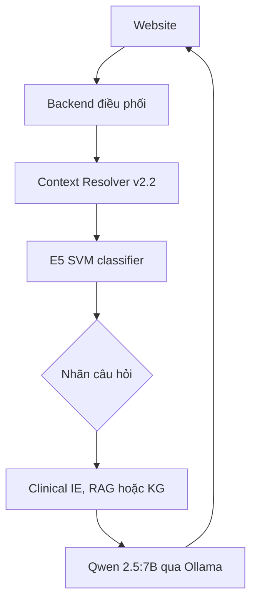

> **Cập nhật v14:** mô tả Clinical IE/X-quang cũ bên dưới được thay thế bởi `../../CLINICAL_MULTIMODAL_UPDATE_VI.md`. Ba luồng mới sử dụng `/api/v1/clinical/analyze`; `/api/v1/files/xray` cũ vẫn không được dùng.

> Tài liệu thiết kế backend gốc, giữ để tham khảo. Cấu hình và đường dẫn chạy bản tích hợp xem `../../README_VI.md`.

# Thiết kế backend điều phối Medical AI Assistant

## 1. Mục tiêu

Backend trung tâm là cổng duy nhất mà website gọi. Backend nhận câu hỏi và tệp đính kèm, khôi phục ngữ cảnh hội thoại, chạy model phân lớp `E5_SVM_seed456.joblib`, gọi module phù hợp, dùng Qwen 2.5:7B cục bộ để tổng hợp kết quả, rồi trả phản hồi theo hợp đồng frontend hiện có.



## 2. Luồng xử lý chat

1. Frontend gọi `POST /api/v1/chat/message` với `conversationId`, `message.id`, `message.content` và các `attachments` đã tải lên.
2. Backend gọi Context Resolver `POST /v1/context/resolve`, truyền:
   - `patient_id`: ID phạm vi phiên; bản đầu dùng `conversationId` để tách dữ liệu giữa hội thoại.
   - `session_id`: `conversationId`.
   - `message_id`: ID tin nhắn của frontend.
   - `question`: nội dung câu hỏi gốc.
   - `timestamp`: thời điểm ISO 8601.
3. Nếu `resolution_status` là `unresolved`, backend trả câu hỏi làm rõ thay vì đoán chủ thể. Nếu phân giải được, dùng `normalized_question` cho bước sau.
4. Backend mã hóa câu hỏi bằng E5 và gọi SVM. Nhãn dùng trong điều phối là tên lớp, không dựa trực tiếp vào số ID.
5. Backend gọi module tương ứng. Với nhãn 4, gọi RAG và KG đồng thời.
6. Backend gửi câu hỏi, kết quả module, cảnh báo và bằng chứng cho Qwen 2.5:7B qua Ollama. Qwen diễn đạt câu trả lời dựa trên dữ liệu nhận được, giữ nguồn trích dẫn và nêu rõ khi dữ liệu thiếu.
7. Backend lưu tin nhắn, thêm lượt assistant vào lịch sử Context Resolver qua `POST /v1/history/turns`, rồi trả `{ "message": ... }` cho frontend.

Nhãn `OUT_OF_SCOPE` được trả bằng thông báo cố định, không gọi module tri thức hoặc LLM.

## 3. Bảng định tuyến

| Nhãn model | Module được gọi | Dữ liệu đưa sang Qwen |
|---|---|---|
| `DIAGNOSTIC_ASSESSMENT` | Clinical IE `POST /api/v1/ask-symptoms` với `{"text": normalized_question}` | JSON kết quả Clinical IE; trình bày như thông tin hỗ trợ, không khẳng định là chẩn đoán xác định |
| `OUT_OF_SCOPE` | Không gọi module | Không gọi Qwen; trả thông báo ngoài phạm vi |
| `GENERAL_MEDICAL_QUERY` | RAG `POST /api/v1/rag/search` với `query`, `kind`, `top_k`, `filters` | `results` và thông tin nguồn |
| `RELATIONAL_QUERY` | KG `POST /api/v1/kg/query` với `question`, `mentions`, `intents` | `llm_context.facts`, `llm_context.sources`, `warnings` |
| `CLINICAL_EXPLANATION_MANAGEMENT` | Gọi RAG và KG song song | Kết quả và nguồn của cả hai module |

Nếu module trả `no_facts`, `no_entity` hoặc `needs_clarification`, Qwen không được biến kết quả rỗng thành khẳng định phủ định. Backend chuyển trạng thái và cảnh báo đó vào prompt.

## 4. Hợp đồng API cho frontend

Các đường dẫn sau khớp với frontend trong `medical-ai-assistant-source.zip`.

### Gửi câu hỏi

`POST /api/v1/chat/message`

Request chính:

```json
{
  "conversationId": "conversation-uuid",
  "message": {
    "id": "message-uuid",
    "role": "user",
    "content": "Nó có triệu chứng gì?",
    "attachments": []
  }
}
```

Response:

```json
{
  "message": {
    "id": "assistant-message-uuid",
    "role": "assistant",
    "content": "Nội dung trả lời kèm nguồn khi có.",
    "createdAt": "2026-09-27T06:00:00Z"
  }
}
```

### Tệp đính kèm

- `POST /api/v1/files/medical-record` — multipart `file`, `clientId`.
- `POST /api/v1/files/xray` — multipart `file`, `clientId`.
- `GET /api/v1/files/{id}` — trả trạng thái xử lý nếu bất đồng bộ.

Backend lưu file và trả `Attachment` tương thích frontend. Clinical IE có `POST /api/v1/analyze-file`, nhưng tài liệu gói chưa xác nhận hỗ trợ giải thích ảnh X-quang. Vì vậy không được gửi ảnh cho Qwen dạng văn bản hoặc trình bày ảnh như đã được phân tích. Muốn phân tích ảnh cần endpoint/module ảnh phù hợp.

### Các API khác của frontend

- `GET /api/v1/status`
- `GET /api/v1/conversations`
- `GET /api/v1/conversations/{id}`
- `PATCH /api/v1/conversations/{id}` với `{"title":"..."}`
- `DELETE /api/v1/conversations/{id}`

## 5. Module và hợp đồng đã xác minh từ gói đính kèm

| Module | Endpoint chính | Ghi chú tích hợp |
|---|---|---|
| Context Resolver v2.2 | `POST /v1/context/resolve`; `POST /v1/history/turns` | Giải quyết đại từ, trả `normalized_question`; lưu lượt người dùng và lượt assistant. Có Patient Assertion Gate cho dữ kiện bệnh nhân. |
| Clinical IE API v3 | `POST /api/v1/ask-symptoms`; `POST /api/v1/analyze-file` | `ask-symptoms` nhận `{ "text": "..." }`. API bọc CLI; cần kiểm tra lỗi phụ thuộc `fcntl` nếu chạy Windows. |
| KG retrieval | `POST /api/v1/kg/query` | Chỉ truy xuất graph và evidence, không gọi LLM. Chấp nhận `question`, tùy chọn `mentions`, `intents`, `limit`, `include_evidence`. |
| Medical RAG | `POST /api/v1/rag/search` | Request có `query`, `kind`, `top_k`, `filters`; mặc định trong `.env.example` là `RAG_MODE=demo`, phải chuyển `live` khi dùng dữ liệu thật. |
| Qwen 2.5:7B | Ollama cục bộ | Backend gọi Ollama; Context Resolver cũng có thể dùng Ollama, nên cần đặt timeout và giới hạn đồng thời để tránh tranh chấp bộ nhớ GPU. |
| E5 SVM | `E5_SVM_seed456.joblib` | File là model SVM; cần dùng đúng encoder E5 và cách tiền xử lý lúc huấn luyện. SVM tuyến tính không tự cung cấp xác suất nếu chưa hiệu chuẩn. |

## 6. Cấu hình triển khai

Địa chỉ module phải nằm trong `.env`, không hard-code:

```dotenv
BACKEND_HOST=127.0.0.1
BACKEND_PORT=8100

CONTEXT_BASE_URL=http://127.0.0.1:<port-context>
CLINICAL_IE_BASE_URL=http://127.0.0.1:<port-clinical-ie>
KG_BASE_URL=http://127.0.0.1:<port-kg>
RAG_BASE_URL=http://127.0.0.1:<port-rag>

OLLAMA_BASE_URL=http://127.0.0.1:11434
OLLAMA_MODEL=qwen2.5:7b

CLASSIFIER_PATH=models/E5_SVM_seed456.joblib
CLASSIFIER_EMBEDDING_MODEL=intfloat/multilingual-e5-base
CLASSIFIER_LABELS_JSON={"0":"DIAGNOSTIC_ASSESSMENT","1":"OUT_OF_SCOPE","2":"GENERAL_MEDICAL_QUERY","3":"RELATIONAL_QUERY","4":"CLINICAL_EXPLANATION_MANAGEMENT"}
```

Các cổng trong gói Clinical IE và RAG đều có ví dụ chạy ở `8000`; không thể đồng thời bind cả hai vào cùng địa chỉ/cổng. Chọn các cổng khác nhau khi khởi chạy, rồi đặt giá trị thật vào `.env`.

## 7. Thông tin còn cần để chạy end-to-end

Thiết kế và adapter có thể bắt đầu với cấu hình hóa. Để kiểm thử chính xác, cần chốt:

1. **Tiền xử lý SVM:** phiên bản/tên E5 dùng khi huấn luyện, có tiền tố `query:` hay không, có chuẩn hóa vector không, và mapping `model.classes_` sang năm nhãn. Chỉ có file `.joblib` chưa đủ để bảo đảm vector inference khớp vector huấn luyện.
2. **Cổng chạy thực tế** của Context, Clinical IE, RAG, KG và backend. Context/Clinical IE/RAG có thể đang mặc định dùng các cổng trùng nhau.
3. **Chế độ RAG:** xác nhận server RAG đang dùng `live` và kết nối đúng MongoDB/Qdrant trước khi đánh giá câu trả lời trên dữ liệu thật.
4. **Ảnh X-quang:** cần xác nhận module/API nào thực sự nhận ảnh để phân tích. Các API đã đọc chưa xác nhận endpoint phân tích ảnh.

## 8. Quy tắc an toàn vận hành

- Không trả lỗi hoặc dữ liệu thô từ module thành câu trả lời y khoa mà không qua kiểm tra/tổng hợp.
- Giữ `doc_id`, `evidence_id`, proposition/source IDs khi tổng hợp và hiển thị nguồn.
- Nếu module thất bại, báo rõ module nào không phản hồi; không bịa phần kết quả bị thiếu.
- Dùng timeout riêng cho từng module, giới hạn retry và ghi log `request_id` để dò lỗi.
- Không đưa khóa bí mật vào biến `VITE_*` của frontend.
- Khi chưa có đăng nhập, đặt ngữ cảnh bệnh nhân theo phạm vi hội thoại để tránh trộn dữ kiện giữa các phiên.
